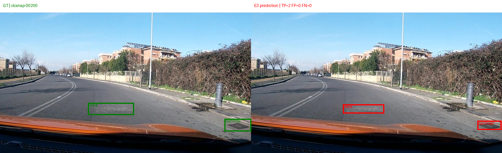
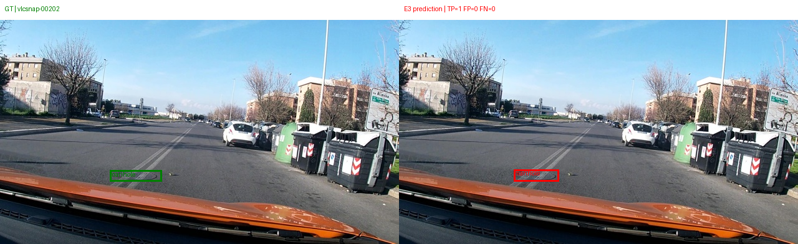
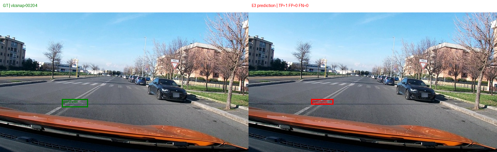
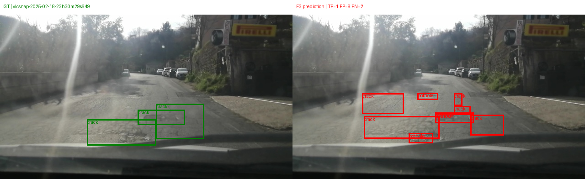
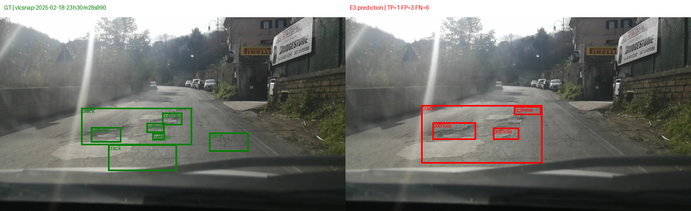
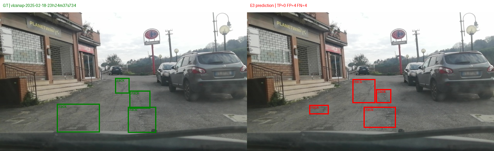

# Báo cáo Lab Day 10 — Võ Minh Quân (2A202602429)

`dataset_version`: `d10-21e4070301`  
Tập test: 311 ảnh; IoU = 0,5; tọa độ dự đoán chuẩn hóa 0–1000. Các số dưới đây lấy từ `report/evidence/*.json` do `scripts/score.py` tạo.

## Bảng tổng hợp

| Mã | Setup | Tham số huấn luyện | VRAM đỉnh (GB) | Phút train | F1 | CI95 | FP/ảnh | F1 pothole | F1 crack | F1 manhole |
|---|---|---:|---:|---:|---:|---|---:|---:|---:|---:|
| E0 | zero-shot | 0 | — | — | 0,0986 | [0,0704; 0,1288] | 0,7910 | 0,1379 | 0,0206 | 0,2324 |
| E1 | LoRA LLM | 33 030 144 | 6,867 | 45,873 | 0,2724 | [0,2363; 0,3090] | 1,2251 | 0,1717 | 0,2099 | 0,5179 |
| E2 | LoRA LLM + projector | 142 135 296 | 8,682 | 46,379 | 0,3324 | [0,2925; 0,3722] | 1,0772 | 0,1818 | 0,2686 | 0,5912 |
| E3 | E2 + LoRA ViT | 148 426 752 | 8,874 | 49,141 | 0,4367 | [0,3978; 0,4778] | 0,9453 | 0,2784 | 0,3587 | 0,7047 |
| E4: 10% | E3, 142 ảnh train | 148 426 752 | 8,282 | 48,579 | 0,2720 | [0,2401; 0,3070] | 2,0064 | 0,1700 | 0,1962 | 0,5800 |
| E4: 100% | E3, 1422 ảnh train | 148 426 752 | 8,874 | 49,141 | 0,4367 | [0,3978; 0,4778] | 0,9453 | 0,2784 | 0,3587 | 0,7047 |
| E5 (bonus) | E3 + GRPO 60 bước | 148 426 752 | 6,915 | 27,601 | 0,4501 | [0,4107; 0,4916] | 0,8714 | 0,3410 | 0,3499 | 0,7219 |

## Ảnh minh họa

Khung xanh = nhãn đúng (GT), khung đỏ = dự đoán E3; TP/FP/FN tính ở IoU ≥ 0,5. Sáu ảnh `gt_*.png` (chỉ GT) dùng để kiểm tra bộ đổi nhãn YOLO → 0–1000.

| Ảnh | Kết quả E3 | Nhận xét |
|---|---|---|
|  | TP=2, FP=0, FN=0 | Đúng: crack và manhole đều khớp |
|  | TP=1, FP=0, FN=0 | Đúng: một manhole |
|  | TP=1, FP=0, FN=0 | Đúng: một manhole |
|  | TP=1, FP=8, FN=2 | Sai: mặt đường hư hỏng dày đặc, model chia nhỏ thành 9 box (cả pothole lẫn crack) trong khi GT chỉ có 3 crack |
|  | TP=1, FP=3, FN=6 | Sai: một box crack lớn gộp vùng có nhiều pothole nhỏ |
|  | TP=0, FP=4, FN=4 | Sai: đúng lớp crack nhưng box lệch vị trí/kích thước, IoU < 0,5 |

## 10 câu hỏi

### Câu 1 — Kiến trúc và tham số được cập nhật

Qwen3-VL-4B có LLM và embedding khoảng 4,0 tỷ tham số, ViT khoảng 415 triệu; trong nhánh thị giác, merger khoảng 27 triệu và ba deepstack merger khoảng 82 triệu. Tổng xấp xỉ 4,44 tỷ. E1 chỉ huấn luyện LoRA trên 252 module LLM; E2 thêm toàn bộ projector ở float32; E3 thêm LoRA trên 96 module ViT (tổng 348 module LoRA). `meta.trainable_params` đo được: E1 = 33 030 144; E2 = 142 135 296, tăng 109 105 152 tham số do projector; E3 = 148 426 752, nhiều hơn E2 6 291 456 tham số do LoRA ViT.

### Câu 2 — E0

`parse_valid_rate = 0,9614` (299/311 output hợp lệ). Hai lỗi có tác động lớn nhất là bỏ sót box (FN = 540) và box dự đoán không khớp, đặc biệt ở lớp crack (FP crack = 182 trong tổng FP = 246). Có 12 output không parse được; 35 output hợp lệ là danh sách rỗng `[]`. Ví dụ output thô bị hỏng của ảnh `vlcsnap-2025-02-18-23h14m04s766`:

```text
[{"label":"manhole","bbox_2d": [889, 697, 1000, 776]}, {"label":"manhole","bbox_2d": [45, 597, 193, 657)}]
```

### Câu 3 — Thang tọa độ

Nhãn và prompt dùng tọa độ 0–1000; cùng một box giữ nguyên giá trị khi ảnh thay đổi độ phân giải, đúng quy ước grounding của Qwen3-VL. `scripts/score.py` mặc định chấm `norm1000`. Nếu cố diễn giải các số này thành pixel, box bị co hoặc dãn theo kích thước ảnh khi quy về 0–1000, làm IoU và F1 giảm. Cùng file `work/e1_test.jsonl` cho F1 = 0,2724 với `norm1000`; khi cố tình chấm bằng `--coord pixel`, F1 = 0,0000 (CI95 [0; 0]). Chỉ thay đổi tùy chọn của script chấm, không đổi dự đoán.

### Câu 4 — Mask loss

`encode_example` xác nhận prompt là tiền tố của chuỗi hoàn chỉnh, rồi đặt label của mọi token prompt và placeholder ảnh thành `-100`; label của phần JSON trả lời và token kết thúc vẫn được giữ. Preflight cho ảnh 640×360 cho 220 token thị giác và giải mã phần được học đúng bằng JSON đáp án cộng `<|im_end|>`. Nếu tính loss trên prompt và token ảnh, gradient dành cho việc dự đoán lại đầu vào, làm mục tiêu tạo JSON định vị bị pha loãng.

### Câu 5 — Projector và lượng tử hóa

Projector thuộc `model.visual`: nếu lượng tử hóa ViT 4-bit, các lớp merger không còn trọng số nổi đầy đủ để cập nhật như yêu cầu E2/E3. Cấu hình nạp model giữ `model.visual` và `lm_head` ngoài 4-bit, đóng băng phần còn lại, rồi chuyển merger và deepstack merger sang float32 trước khi bật gradient. Float32 giữ phép cập nhật của hơn 100 triệu tham số projector ổn định trong khi LLM dùng NF4 và phép tính fp16.

### Câu 6 — Split theo phiên quay

Khung hình gần nhau trong cùng phiên có nền, góc máy và tình trạng đường rất giống nhau. Chia từng ảnh ngẫu nhiên có thể để những khung gần trùng ở cả train và test, tạo F1 cao giả; chia theo session ngăn rò rỉ đó. `check-data` đã xác nhận mỗi session chỉ nằm trong một split. Phân bố thực tế:

| Split | Ảnh | Pothole | Crack | Manhole |
|---|---:|---:|---:|---:|
| Train | 1422 | 1074 | 1750 | 691 |
| Val | 276 | 66 | 470 | 103 |
| Test | 311 | 121 | 299 | 163 |

### Câu 7 — So sánh E1/E2/E3

E2 hơn E1 0,0600 F1 (0,3324 so với 0,2724), dùng thêm 1,816 GB VRAM và 0,506 phút train. Hai CI95 vẫn chồng một phần ([0,2925; 0,3090]), nên cần thận trọng khi khẳng định hơn hẳn. E3 hơn E2 0,1043 F1 (0,4367 so với 0,3324); VRAM tăng 0,191 GB và thời gian train tăng 2,762 phút. CI95 của E3 [0,3978; 0,4778] không chồng CI95 E2 [0,2925; 0,3722]. E3 cho F1 cao nhất trong ba setup, với chi phí VRAM tăng khoảng 2,007 GB so với E1.

### Câu 8 — Độ bất định của tập test

Với 311 ảnh, CI95 bootstrap của E0 là [0,0704; 0,1288], rộng 0,0584 điểm F1. CI95 của E1 là [0,2363; 0,3090] (rộng 0,0727); E2 là [0,2925; 0,3722] (rộng 0,0798). Chênh lệch điểm F1 E2–E1 là 0,0600, nhưng hai khoảng vẫn chồng lấn; muốn kết luận thống kê cần bootstrap theo cặp trên cùng 311 ảnh. CI95 của E3 là [0,3978; 0,4778], rộng 0,0800. Khoảng E3 không chồng khoảng E2, nhưng CI riêng lẻ không thay thế được khoảng tin cậy cho *chênh lệch theo cặp* trên cùng ảnh.

### Câu 9 — Lỗi theo lớp và ảnh minh họa

Ở E0, crack kém nhất: F1 = 0,0206, TP = 5, FP = 182, FN = 294; một số output tạo hàng loạt box crack lặp. Ở setup tốt nhất E3, pothole kém nhất: F1 = 0,2784 (TP = 27, FP = 46, FN = 94), so với crack 0,3587 và manhole 0,7047. Test có 121 box pothole, ít hơn crack (299) và manhole (163). Box GT pothole có diện tích trung vị 0,419% ảnh, nhỏ hơn manhole (0,669%) và crack (1,981%). Trong 121 pothole GT, E3 ghép đúng 10/60 box dưới trung vị và 17/61 box từ trung vị trở lên; kích thước nhỏ có thể góp phần làm khó định vị, nhưng đây chỉ là phân tích mô tả. Ảnh `e3_05_vlcsnap-2025-02-18-23h30m28s990.png` minh họa cảnh có bốn pothole và ba crack: E3 đạt TP=1, FP=3, FN=6. Ảnh `e3_01_vlcsnap-00200.png` minh họa hai box crack/manhole đều khớp (TP=2, FP=FN=0).

### Câu 10 — E4

Biến được thay đổi duy nhất là `data_size`: 10% so với 100% ảnh train, cùng setup tốt nhất E1–E3, seed 42 và các siêu tham số còn lại. F1 giảm từ 0,4367 [0,3978; 0,4778] ở 100% xuống 0,2720 [0,2401; 0,3070] ở 10%; chênh 0,1647 và hai CI95 không chồng nhau. Cùng 300 bước train, 10% dữ liệu làm FP/ảnh tăng từ 0,9453 lên 2,0064. Kết quả trên 311 ảnh test ủng hộ việc dùng đủ dữ liệu cho cấu hình này; không suy rộng sang seed, nguồn ảnh hoặc mức dữ liệu khác.

## Bonus E5

**Reward.** `bonus_reward.reward_iou` dùng đúng `parse_output` và luật ghép của `score.py` (cùng lớp, IoU ≥ 0,5, ghép tham lam theo IoU giảm dần). JSON hỏng → 0; GT rỗng và dự đoán `[]` → 1; còn lại `0,2 + 0,8 · ΣIoU_khớp / max(#GT, #pred)`. Mẫu số `max(#GT, #pred)` phạt cả box thừa lẫn bỏ sót. `python -m unittest test_bonus_reward.py`: 6 test đều qua (JSON hỏng, đúng hoàn toàn, sai lớp = 0,2, thừa một box = 0,6, cả hai rỗng, batch TRL).

**Chạy GRPO.** Khởi tạo từ E3 (SFT tốt nhất), 60 bước, 4 sinh mẫu/ảnh, lr 5e-6, `beta = 0`, `max_completion_length = 128`. Thời gian 27,60 phút, VRAM đỉnh 6,915 GB. Log đầy đủ: `report/logs/e5_run.json`.

| Bước | 5 | 10 | 15 | 20 | 25 | 30 | 35 | 40 | 45 | 50 | 55 | 60 |
|---|---|---|---|---|---|---|---|---|---|---|---|---|
| Reward TB | 0,382 | 0,339 | 0,408 | 0,338 | 0,326 | 0,259 | 0,345 | 0,299 | 0,576 | 0,296 | 0,422 | 0,510 |
| Độ dài TB (token) | 59,0 | 66,6 | 71,5 | 53,5 | 57,3 | 69,3 | 55,1 | 70,5 | 50,0 | 70,4 | 54,8 | 53,4 |

Reward trung bình 6 log đầu 0,342, 6 log sau 0,408; dao động lớn vì mỗi log chỉ gồm vài ảnh, nên chưa thấy xu hướng rõ. `grad_norm` ở log bước 5 là NaN (GradScaler fp16 bỏ qua bước đó); các log sau hữu hạn (0,67–2,41).

**So với SFT (E3), cùng 311 ảnh test.**

| | F1 | CI95 | FP/ảnh | TP / FP / FN | F1 pothole | F1 crack | F1 manhole |
|---|---:|---|---:|---|---:|---:|---:|
| E3 (SFT) | 0,4367 | [0,3978; 0,4778] | 0,9453 | 245 / 294 / 338 | 0,2784 | 0,3587 | 0,7047 |
| E5 (GRPO) | 0,4501 | [0,4107; 0,4916] | 0,8714 | 248 / 271 / 335 | 0,3410 | 0,3499 | 0,7219 |

E5 tăng F1 0,0134, giảm 23 FP và thêm 3 TP; pothole tăng rõ nhất (+0,063), crack giảm nhẹ (−0,009). Hai CI95 chồng lấn gần hết, nên **không kết luận được** GRPO tốt hơn SFT; cần bootstrap theo cặp và nhiều seed.

**Kiểm tra reward hacking** (tính trên `work/e3_test.jsonl` và `work/e5_test.jsonl`, 311 ảnh):

| | Output hỏng | Output `[]` | Tổng box | Box/ảnh | Diện tích box trung vị | p95 | Lớn nhất | Box > 25% ảnh |
|---|---:|---:|---:|---:|---:|---:|---:|---:|
| E3 | 0 | 0 | 539 | 1,733 | 0,950% | 8,77% | 18,58% | 0 |
| E5 | 0 | 0 | 519 | 1,669 | 0,916% | 8,75% | 17,75% | 0 |

Hai kiểu hack có thể có với reward này: (1) trả `[]` để nhận 1,0 ở ảnh không có GT, hoặc nhận mức sàn 0,2 an toàn; (2) phát box khổng lồ để phủ nhiều GT. Cả hai đều không xuất hiện: E5 không có output `[]`, không có box > 25% ảnh, phân bố diện tích gần như giữ nguyên. Thay đổi quan sát được là E5 phát ít box hơn (−20), khớp với việc mẫu số `max(#GT, #pred)` phạt box thừa. Mức sàn 0,2 cho mọi JSON hợp lệ vẫn là điểm yếu: với 60 bước và `beta = 0` chưa thấy hack, nhưng huấn luyện lâu hơn nên theo dõi tỉ lệ `[]` và số box/ảnh.

## Nhìn lại

- Lần chạy Kaggle đầu tiên, E1 dừng ở bước 10/300 vì một box YOLO hợp lệ nhưng rất mỏng bị làm tròn thành `y1 == y2`. Bộ đổi nhãn hiện mở rộng chiều bị co lên tối thiểu một đơn vị 0–1000; có test CPU cho trường hợp này.
- Trên T4 (fp16, không có bf16), ViT phải giữ fp16 và trọng số huấn luyện (projector, LoRA) phải giữ float32 cho GradScaler. TRL 1.9.2 tự ép tham số huấn luyện sang bf16 trong GRPO, nên phải khôi phục float32 trước khi tạo optimizer.
- Mỗi lần train SFT mất 46–49 phút trên T4, gần gấp đôi ước lượng 20–30 phút của đề.
- Thứ tự F1 E1 < E2 < E3 khớp kỳ vọng: mở thêm khối thị giác giúp định vị. Nhưng 311 ảnh test cho CI95 rộng ≈ 0,07–0,08, nên chỉ chênh lệch E3–E2 và E4 (10% vs 100%) đủ lớn để CI không chồng. Nếu làm lại, tôi sẽ thêm bootstrap theo cặp và chạy ≥ 2 seed cho mỗi setup.
